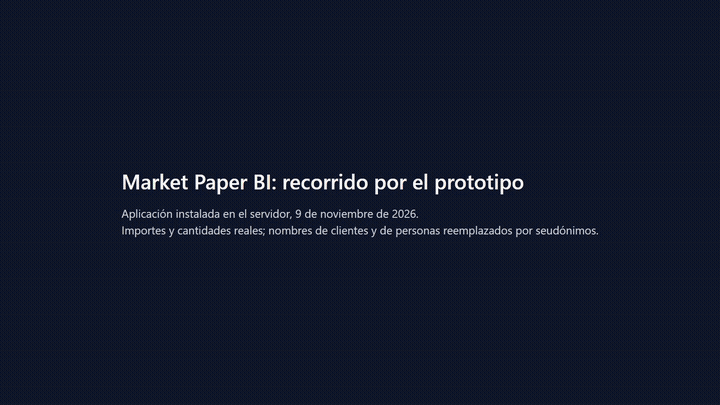

# Market Paper BI

Prototipo de inteligencia de negocios **conversacional y proactiva** para una PyME industrial: junta las ventas del ERP con el CRM, resuelve quién es cada cliente, y sobre un catálogo único de métricas ofrece un tablero, un agente que responde en lenguaje natural y alertas que le asignan una tarea concreta a un vendedor.

Trabajo Final de Grado, Licenciatura en Ciencia de Datos, Universidad Siglo 21. Mariano Berton, noviembre de 2026.



**Video completo (1 min, sin sonido):** [demo/TP4_demo_Berton_Mariano.mp4](demo/TP4_demo_Berton_Mariano.mp4). Importes reales; nombres de clientes y de personas reemplazados por seudónimos.

## Qué hace

- **Una sola base** con las ventas del ERP y los registros del CRM, que conserva el dato original y define cada métrica una sola vez, con fórmula y versión.
- **Cartera mayorista** ordenada por probabilidad de compra a 60 días, con la próxima reposición de cada cliente y las categorías que abandonó.
- **Alertas con responsable**: cliente atrasado, reposición pendiente, categoría abandonada. Cada una propone qué ofrecer y queda en la lista de tareas del vendedor.
- **Agente conversacional** que responde sólo con las métricas del catálogo, muestra la definición que usó, rechaza pedidos de datos personales y no ejecuta nada sin aprobación.
- **Identidad de clientes** entre sistemas: reglas exactas (CUIT, correo) y sugerencias por nombre que una persona aprueba o rechaza.

## Recorrido

| Paso | Pantalla | Qué se ve |
|---|---|---|
| 1 | Ingreso | Cada rol ve lo suyo: la dueña, toda la cartera; la vendedora, su cartera y sus tareas. |
| 2 | Resumen | Ventas netas por canal, ventas en riesgo, alertas abiertas y fecha del último dato de cada fuente. |
| 3 | Cartera mayorista | Clientes por probabilidad de compra, cadencia habitual, próxima reposición y categorías abandonadas. |
| 4 | Ficha del cliente | Compras, ciclo por artículo y alertas abiertas. Sin CUIT, teléfonos ni correos. |
| 5 | Alertas y mis tareas | Regla, responsable y tarea propuesta; se reconoce o se resuelve desde la pantalla. |
| 6 | Agente | Una métrica con su definición; un cliente y qué ofrecerle; un pedido de datos personales, rechazado; una tarea, que pide aprobación. |
| 7 | Administración | Estado de cada carga y revisión de las sugerencias de identidad, una por una. |

## Aplicación en línea

https://mpbi.161-97-160-180.sslip.io. Requiere una cuenta; como muestra datos reales de la empresa, el usuario para el tribunal se entrega a pedido.

<details>
<summary><b>Instalación y ejecución</b> (Anexo E del informe)</summary>

Requisitos: Python 3.12 con `uv`, Node.js con `pnpm`, PostgreSQL 15 o superior; para el servidor, Docker. Las claves (HubSpot, proveedor del modelo de lenguaje) y la conexión a la base van en un archivo de entorno fuera del repositorio.

Entorno de desarrollo, desde la raíz del repositorio de código:

```bash
uv sync --all-packages              # dependencias de Python
pnpm install                        # dependencias de la aplicación web
pnpm db:push                        # aplica las migraciones
uv run mpbi seed load               # mapeos de sucursales y vendedores
uv run mpbi ingest erp              # reportes del ERP (data/erp/inbox)
uv run mpbi ingest hubspot --since 2025-01-01
uv run mpbi identity                # identidad de clientes
uv run mpbi transform               # vistas materializadas
uv run mpbi model recompra          # probabilidad de compra
uv run mpbi alerts run              # reglas de alerta
uv run uvicorn metrics_api.main:app # API de métricas
pnpm --filter web dev               # aplicación web
uv run pytest -q                    # pruebas automáticas
uv run mpbi catalog validate        # validación del catálogo
```

Servidor: un solo guion instala o actualiza todo (imágenes, base, migraciones, servicios y tareas programadas de carga, alertas y respaldo).

```bash
bash deploy/vps/instalar.sh                      # instala o actualiza
deploy/vps/usuario.sh <correo> <rol>             # crea un usuario
bash scripts/pipeline.sh diaria|hubspot|alertas  # corre una tarea a mano
```

</details>

## Sobre este repositorio

Publica el demo y el tutorial. El código fuente permanece en un repositorio privado. Los datos de la empresa son confidenciales: acá no hay código, datos, claves ni capturas con nombres reales.
