# Market Paper · Inteligencia comercial

**Que ningún cliente se vaya sin que alguien lo llame.** Una plataforma para la venta mayorista de una PyME industrial: mira cada cuánto compra cada cliente, avisa cuando alguien se aparta de su ritmo, dice qué ofrecerle y mide cuánto se recuperó.

Prototipo del Trabajo Final de Grado de Mariano Berton (Licenciatura en Ciencia de Datos, Universidad Siglo 21, noviembre de 2026), construido para Market Paper, una fábrica de cartón con tres canales de venta.

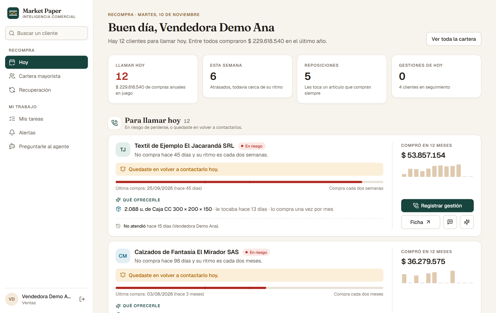

## Probarlo

**Instancia de demostración** con una cartera inventada de 160 clientes mayoristas: https://demo-mpbi.161-97-160-180.sslip.io

| Entrás como | Usuario | Clave | Qué ves primero |
|---|---|---|---|
| Vendedora | ventas@mpbi-demo.ar | H8sBcPEiuyeF | Su agenda de hoy |
| Dirección | direccion@mpbi-demo.ar | PhdLNEz671UN | El resumen del negocio |
| Administración | administracion@mpbi-demo.ar | CkJT77O3YAgK | Lo anterior más fuentes e identidad |

Los datos son sintéticos y se regeneran todas las noches: podés registrar gestiones, resolver alertas y preguntarle al agente sin romper nada. Funciona en el celular.

## Qué resuelve

| | |
|---|---|
| **Hoy** · A quién llamar, por qué y qué ofrecerle. Cada tarjeta trae el motivo en una frase, el artículo que le toca reponer y un mensaje listo para copiar. | 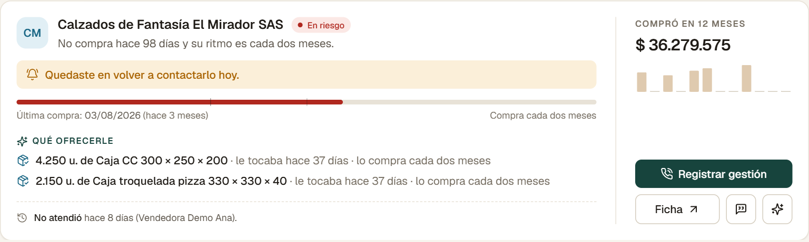 |
| **Registrar la gestión** en dos toques: qué pasó y cuándo lo volvés a contactar. El cliente sale de la lista y vuelve solo ese día. | 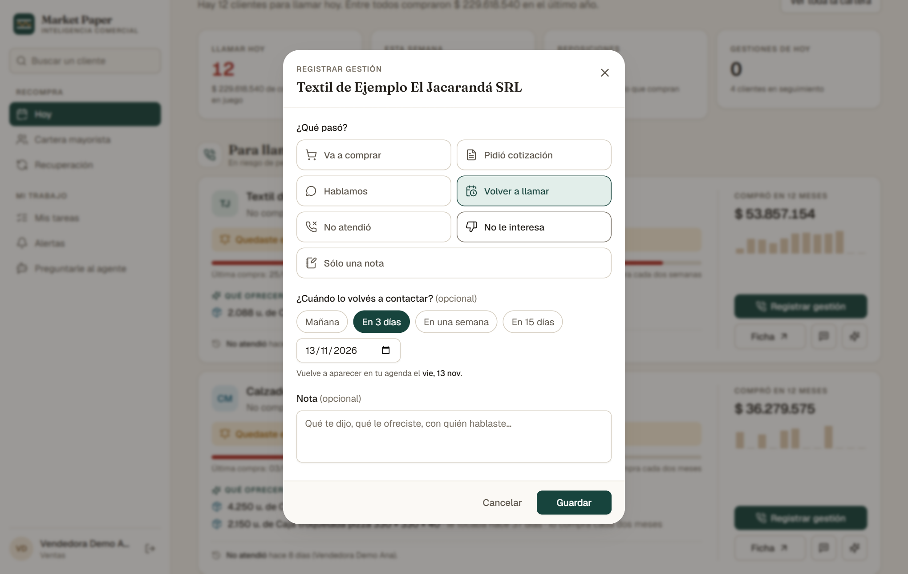 |
| **Cartera mayorista** · Todos los clientes por estado (al día, por reponer, atrasado, en riesgo, inactivo), con su ritmo de compra y doce meses de historia a la vista. | 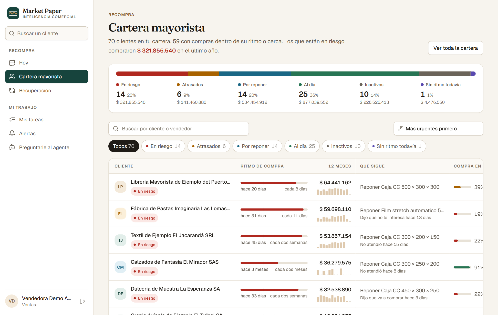 |
| **Ficha del cliente** · Su ritmo de compra dibujado: cada compra en una línea de tiempo y la fecha en que se lo esperaba. | 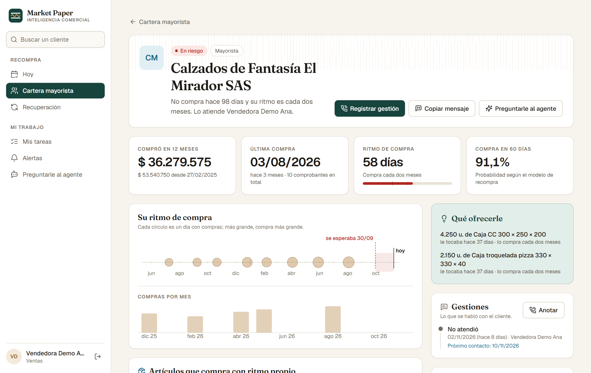 |
| **Recuperación** · Qué pasó después de cada alerta: quién volvió a comprar, cuánto, y si hubo una gestión en el medio. | 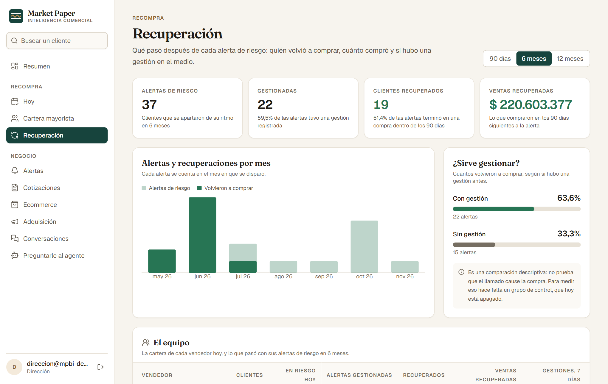 |
| **Resumen** para la dirección · Ventas por canal, la cartera por estado y lo que hay que atender. | 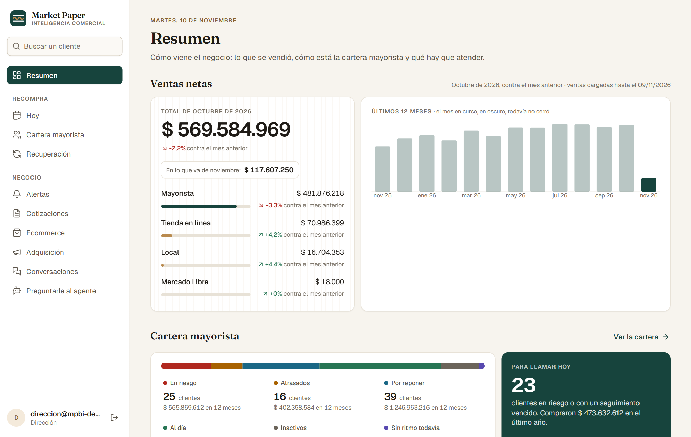 |
| **Agente** · Preguntas en lenguaje natural que se responden sólo con métricas definidas en un catálogo, mostrando la definición usada. No muestra datos personales ni ejecuta nada sin aprobación. | 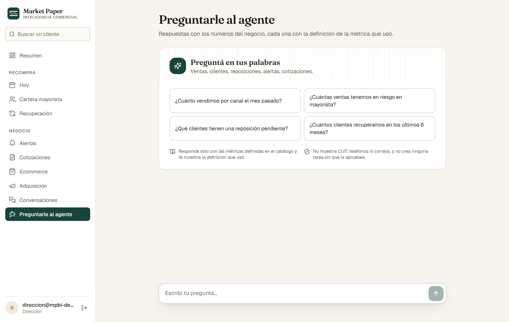 |

En el celular:

<p>
  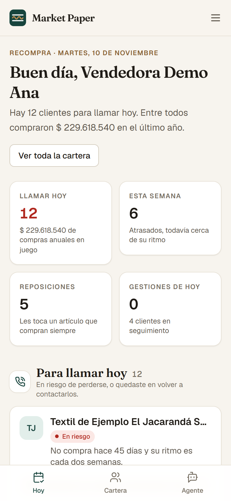
  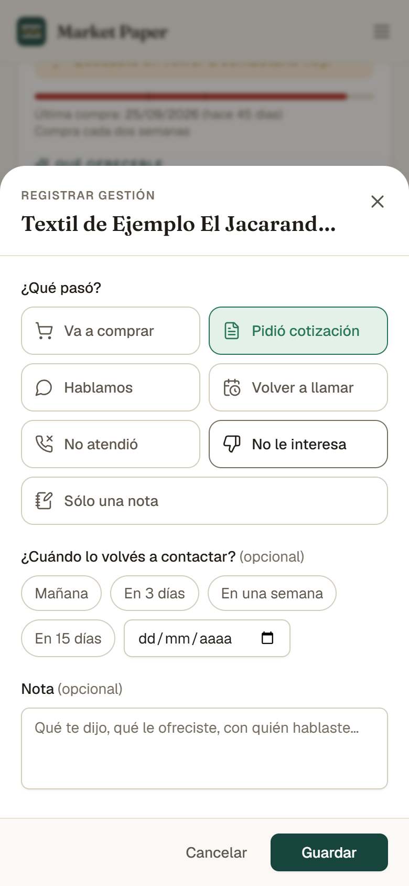
  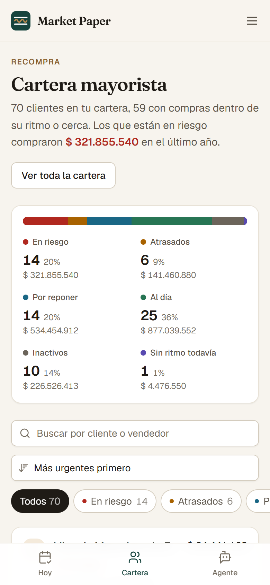
</p>

## Cómo funciona

1. **Una sola base.** Las ventas del ERP y los registros del CRM se cargan en capas que conservan el dato original; cada cliente se identifica igual en los dos sistemas (reglas exactas por CUIT y correo, y sugerencias por nombre que una persona aprueba).
2. **Un catálogo de métricas.** Cada número tiene una única definición, con fórmula y versión, que usan por igual las pantallas, las alertas y el agente.
3. **El ritmo de cada cliente.** Con su historia de compras se calcula cada cuánto compra, cuánto se apartó de ese ritmo y la probabilidad de que compre en los próximos 60 días (modelo de supervivencia en tiempo discreto, evaluado con cortes temporales).
4. **Alertas con responsable.** Riesgo de pérdida, reposición pendiente y categoría abandonada: cada una va a una persona con una tarea concreta.
5. **Gestión y recuperación.** Lo que la vendedora anota queda en la ficha y alimenta el seguimiento: cuántos clientes en riesgo volvieron a comprar y cuánto.

## Video del recorrido

[demo/TP4_demo_Berton_Mariano.mp4](demo/TP4_demo_Berton_Mariano.mp4) (1 minuto, sin sonido). Corresponde a la versión entregada el 9 de noviembre de 2026; la instancia de demostración ya tiene el rediseño que se ve en las capturas de arriba.

<details>
<summary><b>Instalación y ejecución</b> (Anexo E del informe)</summary>

Requisitos: Python 3.12 con `uv`, Node.js con `pnpm`, PostgreSQL 15 o superior; para el servidor, Docker. Las claves (HubSpot, proveedor del modelo de lenguaje) y la conexión a la base van en un archivo de entorno fuera del repositorio.

Entorno de desarrollo, desde la raíz del repositorio de código:

```bash
uv sync --all-packages              # dependencias de Python
pnpm install                        # dependencias de la aplicación web
pnpm db:push                        # aplica las migraciones
uv run mpbi seed load               # mapeos de sucursales y vendedores
uv run mpbi ingest erp              # reportes del ERP (data/erp/inbox)
uv run mpbi ingest hubspot --since 2025-01-01
uv run mpbi identity                # identidad de clientes
uv run mpbi transform               # vistas materializadas
uv run mpbi model recompra          # probabilidad de compra
uv run mpbi alerts run              # reglas de alerta
uv run uvicorn metrics_api.main:app # API de métricas
pnpm --filter web dev               # aplicación web
uv run pytest -q                    # pruebas automáticas
uv run mpbi catalog validate        # validación del catálogo
```

Servidor: un solo guion instala o actualiza todo (imágenes, base, migraciones, servicios y tareas programadas).

```bash
bash deploy/vps/instalar.sh                      # instala o actualiza
deploy/vps/usuario.sh <correo> <rol>             # crea un usuario
bash deploy/vps/instalar_demo.sh                 # instancia de demostración con datos sintéticos
```

</details>

## Sobre este repositorio

Publica el demo y el tutorial. El código fuente permanece en un repositorio privado. Los datos de la empresa son confidenciales: acá no hay código, datos ni claves, y todas las capturas son de la instancia de demostración, con clientes inventados.
